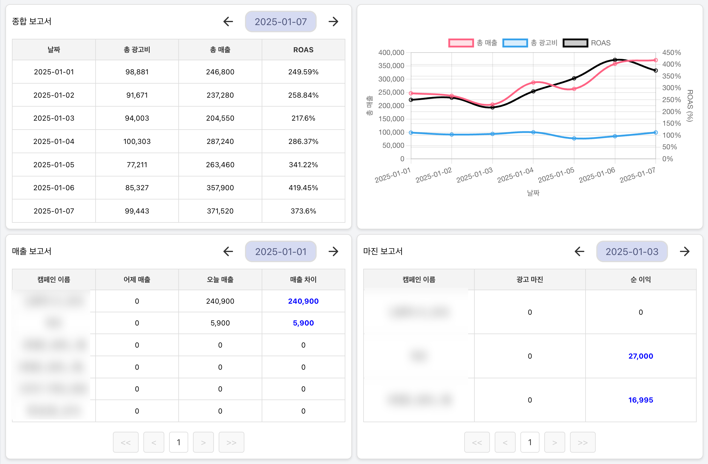

# GrouUp (그로우업)

> **이커머스 개인 셀러를 위한 광고비 통계·마진 분석 대시보드**
>
> 대용량 조회에서 생기는 병목을 측정으로 찾아내고, 인메모리 캐싱·비동기 처리·분산 캐시로 단계적으로 개선한 백엔드 프로젝트입니다.



## 프로젝트 한눈에 보기

| # | 주제 | 한 줄 성과 | 문서 |
|---|---|---|---|
| ① | 크롤링 → 엑셀 업로드 전환 | 요구사항을 다시 정의해 피벗을 제안했고, Bulk Insert와 트랜잭션 분리로 50 PCU·500행 P95 1.5s → 1.08s(당시 측정). 수정 후 로컬 재측정(50명·100행): 단계별 P95 1.92s → 1.05s(약 45% 감소, 대부분 Bulk Insert 효과), 동시 업로드 데드락(S7) 발견·수정 | [01-excel-upload](docs/portfolio/01-excel-upload.md) |
| ② | 6개월 조회와 세그먼트 트리 캐시 | 정합성 수정 후 로컬 재측정: 커버링 인덱스로 P95 463ms → 273ms, 비동기 빌드·자원 분리로 Cold Start P95 2.24s → 1.48s(3회 중앙값). 커넥션 풀 = IO 스레드 풀 10~50 튜닝에서 30이 적정 | [02-segment-tree-cache](docs/portfolio/02-segment-tree-cache.md) |
| ③ | TIMED_WAITING 스레드 200개 | 가설 세 개를 검증해 원인 확인: 스캐너 버스트로 Tomcat 워커 풀이 기본 최대치 200까지 늘었다가 60초 유휴 대기한 것(대조군 `max-threads=50`으로 입증). WAF·Rate Limiter로 버스트를 앞단에서 차단, 월 약 2만 건 | [03-timed-waiting-threads](docs/portfolio/03-timed-waiting-threads.md) |
| ④ | MSA/CQRS 글로벌 캐시 PoC | L1 트리 + L2 Redis + 이벤트 동기화로 Query 서버 3대가 DB 재조회 0회로 같은 값 유지 | [04-global-cache-msa](docs/portfolio/04-global-cache-msa.md) |

> 2026-10-26 코드 분석에서 찾은 결함(캐시 정합성, 엑셀 업로드 등)을 고친 뒤 ①~③을 로컬에서 다시 측정했습니다. 표의 "재측정" 수치가 그 결과입니다. ④ PoC 재측정은 남아 있습니다.
> 결함 목록: [docs/known-issues.md](docs/known-issues.md), 재측정 진행: [docs/remeasure-plan.md](docs/remeasure-plan.md)

## 팀과 역할

- **구성:** 2인 팀 프로젝트 (풀스택). MSA 글로벌 캐시 PoC는 개인 작업입니다.
- **My Role (Backend):**
  - 서비스 기획, DB 스키마 설계, Spring Boot REST API
  - 6개월 조회 최적화를 위한 인메모리 세그먼트 트리 캐시 설계
  - Spring Event + CompletableFuture 비동기 빌드, 스레드·커넥션 풀 분리
  - k6, Prometheus, Grafana 기반 부하 테스트와 모니터링
  - 분산 환경 캐시 정합성 PoC (CQRS, Kafka, Redis)

## 저장소 구조

```
apps/
  api-server/        Spring Boot 3.3 모놀리스 (메인 API)          Java 17, JPA, QueryDSL, Caffeine
  batch-server/      Spring Batch 월별 집계 backfill (WIP)
  web/               React 대시보드 (CRA, Tailwind)
  excel-parser/      Django 쿠팡 광고 리포트 엑셀 파서 (S3, Lambda/Zappa)
poc/
  global-cache-msa/  MSA/CQRS 글로벌 캐시 PoC (Gradle 멀티모듈, Spring Cloud)
load-test/           k6 스크립트와 결과 캡처 (포트폴리오 수치의 근거)
infra/               로컬 MySQL, Prometheus, Grafana compose
docs/
  portfolio/         프로젝트별 상세 문서
  known-issues.md    알려진 결함과 재측정 대상
  deployment.md      운영 당시 배포 구성 기록 (현재 운영 종료, CI/CD 없음)
```

이 저장소는 여러 저장소를 히스토리를 보존한 채 합친 모노레포입니다.

| 경로 | 원본 저장소 |
|---|---|
| `apps/api-server` | 이 저장소 + [grou-up/SpringServer](https://github.com/grou-up/SpringServer) (merge) |
| `apps/web` | [grou-up/FrontServer](https://github.com/grou-up/FrontServer) (subtree) |
| `apps/excel-parser` | [grou-up/PythonServer](https://github.com/grou-up/PythonServer) (subtree, 빌드 산출물·비밀값 제거) |
| `poc/global-cache-msa` | [Hi-Imjaeyoung/global-cache-poc](https://github.com/Hi-Imjaeyoung/global-cache-poc) (subtree) |

## 실행

| 대상 | 명령 |
|---|---|
| 로컬 DB | `cd infra && cp .env.example .env && docker compose up -d` |
| 모니터링 | `cd infra && docker compose -f docker-compose.monitoring.yml up -d` (Grafana :3001) |
| api-server | `cd apps/api-server && ./gradlew bootRun` (환경변수: `DATASOURCE_*`, `JWT_*`, OAuth) |
| api-server 테스트 | `cd apps/api-server && ./gradlew test` (H2 `test` 프로필) |
| batch-server | `cd apps/batch-server && ./gradlew bootRun` |
| web | `cd apps/web && npm ci && npm start` (`REACT_APP_API_URL`) |
| excel-parser | `cd apps/excel-parser && pip install -r requirements.txt && python manage.py runserver` |
| MSA PoC | `cd poc/global-cache-msa && docker compose -f docker/docker-compose.yml up -d && ./gradlew build` |
| 부하 테스트 | [load-test/README.md](load-test/README.md) |

## 기술 스택

| 영역 | 기술 |
|---|---|
| Backend | Java 17, Spring Boot 3, Spring Data JPA, QueryDSL, Spring Security (JWT, OAuth2), Spring Batch |
| Cache / MQ | Caffeine, Redis, Kafka, RabbitMQ (PoC) |
| DB | MariaDB / MySQL (PoC: Master-Slave) |
| Infra | AWS (EC2, S3, Lambda), Docker, GitHub Actions (운영 당시, [배포 기록](docs/deployment.md)) |
| Test / Monitoring | JUnit5, JMH, k6, Prometheus, Grafana, Loki |
| Frontend / 기타 | React (`apps/web`), Django (`apps/excel-parser`) |

## 핵심 코드

아래 링크는 측정 당시 커밋에 고정된 링크입니다. 현재 경로는 `apps/api-server/` 아래입니다.

| 주제 | 링크 |
|---|---|
| 세그먼트 트리 구간 조회 | [LazySegmentTreeService.java#L161-L191 @7825c75](https://github.com/Hi-Imjaeyoung/Grou-up/blob/7825c75c7788ce7fe8865ccaaf9586d4f5367bf8/src/main/java/growup/spring/springserver/global/cache/LazySegmentTreeService.java#L161C1-L191) |
| 비동기 빌드 이벤트 리스너 (Bulkhead) | [CacheBuildEventListener.java#L30-L55 @7825c75](https://github.com/Hi-Imjaeyoung/Grou-up/blob/7825c75c7788ce7fe8865ccaaf9586d4f5367bf8/src/main/java/growup/spring/springserver/global/listener/CacheBuildEventListener.java#L30-L55) |
| 부분 업데이트와 재빌드 임계값 벤치마크 | [TreeCpuBenchmarkTest.java#L37-L57 @921d95a](https://github.com/Hi-Imjaeyoung/Grou-up/blob/921d95aee9a50a781133144a039b16885956f851/src/test/java/growup/spring/springserver/global/cache/TreeCpuBenchmarkTest.java#L37-L57) |

> 포트폴리오 PDF: (링크 추가 예정)
