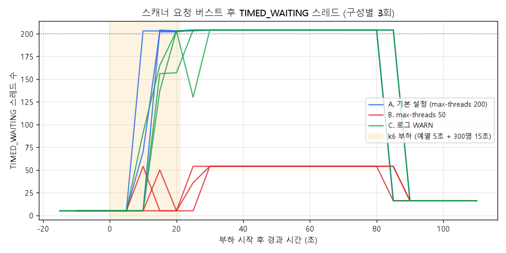

# ③ CPU는 정상인데 스레드는 왜 200개까지 늘었을까

> 운영 서버에서 TIMED_WAITING 스레드가 200개 가까이 늘어난 이상 지표를 관측했습니다.
> - 애플리케이션 내부 가설 두 가지(로그 I/O, 인증 블로킹)는 재현되지 않았습니다.
> - 세 번째 가설을 검증해 원인을 찾았습니다. 스캐너 요청이 한꺼번에 몰리면 Tomcat 워커 풀이 기본 최대치(200)까지 늘어나고, 일이 끝난 워커는 약 60초 동안 새 요청을 기다리다 정리됩니다. 지표가 잡은 것은 이 대기 상태였습니다(2026-10-27 재검증).
> - 스레드 수 자체는 장애가 아니었습니다. WAF와 Rate Limiter는 버스트 동안 스캐너가 워커와 CPU를 차지하지 못하게 앞단에서 거르는 역할로 정리했습니다.

## 관측 (2025-09-13 06:39~06:40)

| 지표 | 값 | 평소 |
|---|---|---|
| TIMED_WAITING 스레드 | ~200 | 5 이하 |
| HTTP duration max | 500ms | — |
| I/O rate | ~20 ops/s | — |
| CPU | 정상 | — |
| 요청 | `GET /frontend/.env`, `GET /conf.php.swp` 등 스캐너 요청 | — |

## 가설과 검증

| 가설 | 검증 방법 | 결과 |
|---|---|---|
| 1. 로그 기록 I/O가 스레드 대기를 유발했다 | k6로 401 요청을 대량 발생, 로그 on/off 비교, VisualVM(JMX)으로 관측 | 부하 차이는 있었지만 TIMED_WAITING 증가는 재현되지 않음 |
| 2. 인증·인가 처리의 블로킹 I/O | 코드 확인(DB·외부 호출 없음) + 401 대량 요청 | CPU ~100%, TIMED_WAITING ~40개. 재현되지 않음 |
| **3. Tomcat 워커 풀이 버스트로 최대치까지 늘었다가 유휴 대기** | 스캐너 요청을 동시 300개로 보내고, 스레드 덤프와 시간대별 스레드 수 관측. `max-threads`를 50으로 줄인 대조군 비교 | **재현됨.** 아래 [재검증](#재검증-2026-10-27) |

> 가설 1 보강: 비동기 Appender는 큐가 가득 차지 않으면 워커 스레드를 블로킹하지 않습니다. 현재 [`logback-spring.xml`](../../apps/api-server/src/main/resources/logback-spring.xml)은 동기 `RollingFileAppender`를 씁니다.

> 당시 401 flood 스크립트와 VisualVM 캡처는 저장소에 없습니다. 재검증에서는 같은 성격의 스캐너 요청 스크립트([`scanner-burst.js`](../../load-test/04-timed-waiting/scripts/scanner-burst.js))를 새로 만들었습니다. 스레드 상태는 VisualVM 화면 대신 `jcmd Thread.print` 덤프와 Prometheus 시계열로 남겼습니다.
>
> 가설 2 검증에서 TIMED_WAITING이 약 40개에 그친 것은 가설 3과 모순되지 않습니다. 워커는 **동시에 처리 중인 요청 수**만큼만 늘어납니다. 당시 부하의 동시 요청 수가 40 안팎이었을 가능성이 큽니다. 다만 당시 VU 수가 남아 있지 않아 확인은 못 했습니다.

## 재검증 (2026-10-27)

**가설 3:**
- 200은 Spring Boot 내장 Tomcat의 `server.tomcat.threads.max` 기본값입니다. 이 프로젝트에는 이 설정이 없습니다.
- 동시에 처리 중인 요청이 200을 넘으면 워커 스레드가 200개까지 만들어집니다.
- 일이 끝난 워커는 `TaskQueue.poll(timeout)`에서 다음 요청을 기다리다, 유휴 시간(기본 60초)이 지나면 최소 유휴 스레드 수(기본 10개)만 남기고 정리됩니다.
- `poll(timeout)` 대기는 JVM에서 TIMED_WAITING으로 보입니다.

**방법:** [`scanner-burst.js`](../../load-test/04-timed-waiting/scripts/scanner-burst.js), [`rerun/run.sh`](../../load-test/04-timed-waiting/rerun/run.sh)
- 당시 로그의 스캐너 요청(`GET /frontend/.env`, `/conf.php.swp`)을 인증 없이 동시 300개로 15초간 보냈습니다. 모두 401입니다.
- 그 뒤 90초 동안 아무 요청도 보내지 않았습니다.
- 스레드 덤프는 부하 직후와 유휴 75초 후 두 번 떴습니다. 스레드 수는 Prometheus(`jvm_threads_states_threads`)로 5초마다 수집했습니다.
- 구성마다 3회 반복했고, 환경은 ①·②와 같은 로컬 PC입니다.

| 구성 | TIMED_WAITING 최고 | 부하 후 최고값 유지 | 부하 직후 덤프: Tomcat 워커 / 그중 `TaskQueue.poll` 대기 | 유휴 75초 후 워커 |
|---|---|---|---|---|
| A. 기본 설정 | 204 (3회 모두) | 58~64초 | 200 / 200 | 12 |
| B. `server.tomcat.threads.max=50` | 54 (3회 모두) | 58~63초 | 50 / 50 | 12 |
| C. A + 로그 레벨 WARN | 204 (3회 모두) | 58~64초 | 200 / 200 | 12 |



- **200은 워커 풀 상한이었습니다.** 상한을 50으로 줄이자 최고값도 54(워커 50 + 그 밖의 TIMED_WAITING 스레드 4개, A의 204도 같은 구성)가 됐습니다.
- **TIMED_WAITING 워커는 모두 일이 없어 기다리는 스레드였습니다.** 부하 직후 덤프에서 워커 전부가 다음 스택에 있었습니다.

  ```
  java.lang.Thread.State: TIMED_WAITING (parking)
      at java.util.concurrent.LinkedBlockingQueue.poll(...)
      at org.apache.tomcat.util.threads.TaskQueue.poll(TaskQueue.java:99)
      at org.apache.tomcat.util.threads.ThreadPoolExecutor.getTask(...)
  ```
- **약 60초 뒤 저절로 줄었습니다.** 부하가 끝나고 58~64초 뒤 워커가 12개로 줄었습니다(Tomcat 기본 유휴 시간 60초, 최소 10개).
- **"CPU는 정상인데 스레드는 200개"가 그대로 재현됐습니다.**
  - 버스트 중에는 CPU가 100%였습니다.
  - 버스트가 끝나고 스레드가 200개로 머문 약 60초 동안 서버 프로세스 CPU는 0~1%였습니다.
  - 당시 지표를 이 구간에서 봤다면 "CPU는 정상인데 스레드만 많은" 모습이 됩니다.
- **로그 레벨과는 무관했습니다(C).** 가설 1을 다시 배제합니다.

결과 원본(k6 요약·로그, 스레드 덤프, Prometheus 시계열)은 [results/2026-10-rerun](../../load-test/04-timed-waiting/results/2026-10-rerun)에 있고, 표와 그래프는 [`summarize.py`](../../load-test/04-timed-waiting/rerun/summarize.py)로 만들었습니다.

## 조치와 결과

- 애플리케이션 앞단에 WAF와 Rate Limiter를 적용해 비정상 요청을 서버 밖에서 차단했습니다. 월 평균 약 20,000건을 차단했습니다.
- **재검증 후 역할 정리:**
  - TIMED_WAITING 200개는 버스트 뒤에 남은 유휴 워커였습니다. 이 스레드들은 1분 안에 저절로 정리되므로 장애가 아니었습니다.
  - 실제 비용은 버스트 그 자체였습니다. 재현에서 스캐너 요청 15초 동안 CPU가 100%였고, 워커 200개가 모두 401 응답에 쓰였습니다. 그동안 정상 사용자의 요청은 같은 워커와 CPU를 두고 경쟁합니다.
  - 따라서 WAF·Rate Limiter의 역할은 "스레드 이상을 고친 것"이 아니라 **스캐너 버스트가 워커 풀과 CPU를 차지하지 못하게 앞단에서 거르는 것**입니다.
- **모니터링 기준:** TIMED_WAITING 개수는 경보 기준으로 맞지 않습니다. 일하는 워커 수(`tomcat_threads_busy_threads`, `server.tomcat.mbeanregistry.enabled=true` 필요)와 요청 대기를 봐야 합니다.

## 회고

- 보안은 민감 데이터 보호를 넘어 가용성을 지키는 역할도 합니다.
- 병목은 코드뿐 아니라 실행 환경(스레드 풀 기본값, OS, 네트워크)에도 있습니다. 이번 원인도 코드가 아니라 Tomcat 기본값과 그 동작 방식이었습니다.
- 숫자가 설정 기본값(200)과 같으면 먼저 의심하고, 대조군(`max-threads=50`)으로 한 번에 확인할 수 있었습니다.
- JVM, 애플리케이션, 네트워크 계층별 지표를 함께 볼 수 있는 관측 환경이 필요합니다.
